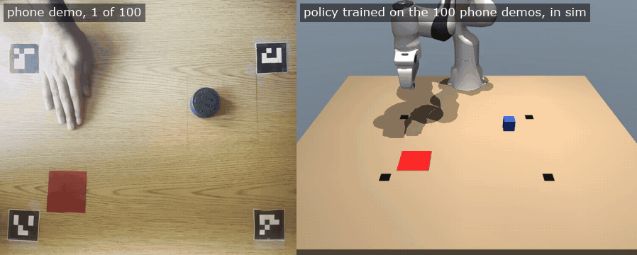
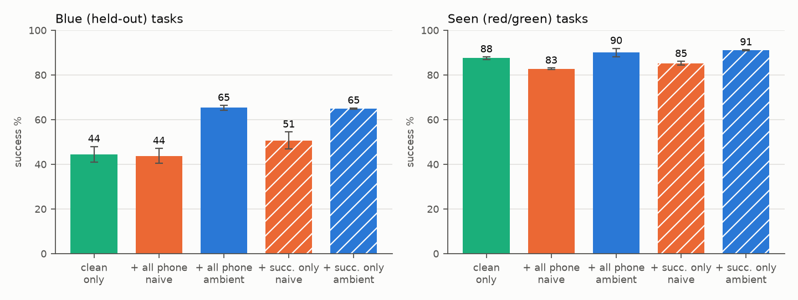
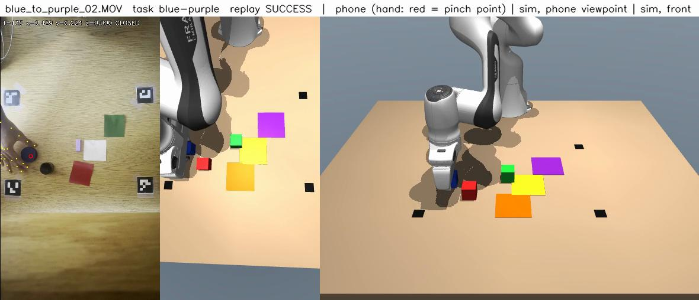

# Phone demos as post-training data for a VLA

*Running log: `NOTES.md`. Phone recording protocol: `RECORDING.md`.*

Robot demonstrations are expensive. A phone video of a person doing the task is cheap, but noisy. Here, phone clips of a
real tabletop task are retargeted into a MuJoCo sim (Franka Panda), replayed there, and used to post-train
SmolVLA (`lerobot/smolvla_base`, 450M).

## Headline: phone-only post-training reaches 95–100% on a single-object task

In this controlled setup (one cube, one target zone, a fixed top-down phone, see [Limitations](#limitations)),
**SmolVLA post-trained only on 100 retargeted phone demos succeeds in 95% of sim episodes at the end of training and
100% at the midpoint checkpoint** (20 episodes each, zero-noise sampling). No robot or sim-expert demos are used.


*Left: one of the 100 phone clips (real time). Right: the policy trained on all 100 clips (final checkpoint,
zero-noise sampling) on an evaluation layout in sim, front camera (real time). The cube start differs between the
two; the policy never saw this layout.*

### Success vs number of demos


| demos | data | midpoint checkpoint % | end of training % (95% CI) |
|---|---|---|---|
| 15 | phone | 85 | 55 (34–74) |
| 30 | phone | 45 | 80 (58–92) |
| 60 | phone | 95 | 80 (58–92) |
| 100 | phone | 100 | 95 (76–99) |
| 15 | clean sim expert | 30 | 95 (76–99) |
| 30 | clean sim expert | 100 | 100 (84–100) |

- Task: "put the blue cube in the red zone". The cube starts anywhere in a 7.7 × 7.7 cm box; the zone is fixed.
  The sim layout distribution matches the real recording layout.
- Phone runs use the first *N* of 100 clips in recording order (nested sets), including the 8% whose sim replay
  failed. Training: from `smolvla_base`, language layers unfrozen, cosine LR over 10k steps (*N* ≤ 30) or 15k steps.
  Midpoint checkpoint = 5k or 7.5k steps.
- About 100 phone demos reach what 15 clean sim-expert demos reach. Phone results are not monotone in *N* at
  20 episodes per point. The intervals are wide (±15–20 points) and each cell is a single training seed.

## Method comparison at 15 phone demos

At 15 demos naive training ends mid-range (55%). Methods compared on the same 15 clips:

- **naive**: flow-matching loss on every clip.
- **ambient**: the 5 best clips by quality score (top 30% of the 15) are clean; the other 10 supervise only the
  high-noise part of the flow (per-clip t_min 0.5–0.9 by score rank).
- **quality-tagged**: each clip's quality score is appended to the state; at test time the policy is asked for high quality.
- **velocity-normalized (VN)**: naive on clips re-timed to a common speed profile (after Tutor Intelligence DF1,
  Sec. 4.2). Cross-episode cruise-speed CV drops from 0.19 to 0.14; sim replay success rises from 92% to 94%.
- **self-improvement**: one round on the best of naive / ambient / quality. That run's policy collects 100 sim
  rollouts, the successful ones are added as clean data, and it trains 3k more steps.


<!-- METHODS TABLE: python scripts/make_figures.py --methods -->
| method | 2.5k | 5k | 7.5k | 10k (40 ep., 95% CI) | validation, 10k |
|---|---|---|---|---|---|
| *baseline: naive, 5k checkpoint* | | 85 | | | |
| naive | 95 | 85 | 50 | 55.0 (40–69) | 67.5 |
| ambient | 75 | 90 | 85 | **92.5 (80–97)** | 85.0 |
| quality-tagged | 85 | 90 | 80 | 87.5 (74–95) | 80.0 |
| velocity-normalized (naive) | | | | *running* | |
| self-improvement (1 round on ambient) | | | | 67.5 (52–80) at 13k | |
<!-- /METHODS TABLE -->

- **Naive training peaks early and then declines** (95% at 2.5k → 55% at 10k). The original run and a rerun with
  the same seed agree, and the decline also shows on the separate validation layouts (95% → 67.5%).
- **Ambient does not decline** and ends at 92.5%. That matches the best naive checkpoint without having to pick it,
  and beats the naive 5k baseline (85%) by about 8 points (within the intervals).
- **Quality tags also hold up** (87.5% at 10k, no late decline) and end 5 points below ambient on both seed sets (within the intervals).
- **Self-improvement made the best run worse.** Ambient won the validation selection (85 vs 80 vs 67.5). Its
  rollouts succeeded 93/100 (sampling noise on), and 3k more steps on those plus the 15 clips dropped it from 92.5% to
  67.5% on the same 40 episodes (11 lost, 1 gained; exact McNemar p ≈ 0.006). The grasp point moved +0.8 cm in x,
  like naive's late drift. Not diagnosed further: the 93 rollouts outweigh the 15 clips and are treated as clean, and
  the LR restarts at 5e-5.
- **The late failures are grasp drift, not copying.** On the same 20 episodes, naive's grasp point moves +0.6 cm in
  x from 5k to 10k (in 15 of 20), away from the training clips' average. The 10k misses are no closer to their
  nearest training clip's grasp than to the average one (`scripts/grasp_vs_train.py`).

Protocol: success at fixed steps (20 episodes; 40 at 10k) on the standard evaluation layouts. The one selection
(which method gets self-improvement) uses separate validation layouts at 10k. Single training seed per method.

## How we got here

**The original setup: 9 tasks, held-out object.** Three cubes and three zones (9 pick-and-place tasks). Plenty of sim
expert data for red and green, few or no robot demos for blue, and phone clips for all tasks. The question was whether
phone demos could teach the held-out blue tasks. For SmolVLA this failed before the phone data mattered:

- **Grounding.** With the VLM frozen, the policy ignored the color in the instruction (grounding probe at chance:
  0.29–0.46 vs 0.33). Unfreezing the language layers grounded red and green (probe 0.8–0.94) but never blue
  (0.03–0.12). Even 40 clean sim demos of a blue task at 30% of each batch left blue at chance (2% success).
- **Per-task demo requirement.** For a single blue task in the three-cube scene, ≥ 50% success took between 160 and
  320 clean sim demos (80: 15%, 160: 40%, 320: 80%). The 38 blue phone replays alone gave 1–3%. So did 38 clean sim
  demos (0–1%). At that data size the phone vs sim question could not be answered.
- **Base-policy grasp precision.** On the seen tasks, failures were mostly missed grasps from closed-loop drift
  (offline grasp error 0.26 cm, closed-loop rms 3.65 cm). Recovery demos (DART-style) and zero-noise sampling moved
  seen success from 39% to 65%.

So the task was constrained to one object and one zone, where clean sim demos reach 95–100% with 15–30 demos. Then
100 phone clips were recorded on the matching real layout.

**The controlled experiment: a small diffusion policy.** A 5.4M-parameter DDPM policy on privileged state (cube and
zone positions, one-hot task) isolates the data and loss question from perception and language. With 4 clean demos
per blue task, the 48 phone replays (9-task setup, 3 seeds each) gave:

| robot demos per blue task | phone demos | loss on phone data | seen % | blue % |
|---|---|---|---|---|
| 0 | none | – | 88.7 (1 seed) | 0.0 |
| 0 | all | naive | 86.0 ± 1.2 | 9.6 ± 2.2 |
| 4 | none | – | 87.6 ± 0.6 | 44.4 ± 3.5 |
| 4 | all | naive | 82.8 ± 0.3 | 43.8 ± 3.3 |
| 4 | 37 successful replays only | naive | 85.2 ± 0.9 | 50.7 ± 3.8 |
| 4 | 37 successful replays only | ambient | 91.0 ± 0.3 | 64.9 ± 0.3 |
| 4 | all | ambient | 90.0 ± 1.9 | **65.3 ± 1.1** |

Naive training on phone data gains nothing; the ambient loss (noisy samples supervise only diffusion steps
t ≥ t_min) raises blue success from 44% to 65%, beats filtering out failed replays, and does not need them removed.
On synthetic phone-like noise the best t_min rises with the noise level, and noisy demos help only when clean data
is scarce (4 per task; from 8 on, discarding them is better).



Figures for the noise sweep and clean-data scaling: `docs/figures/noise_vs_tmin.png`, `docs/figures/clean_scaling.png`;
all numbers in [`docs/results_tables.md`](docs/results_tables.md).

## Phone pipeline

1. **Recording** (`RECORDING.md`): phone 43 cm above the table looking down (0.5× lens); four ArUco markers give
   metric table coordinates in every frame. Session 5: 100 clips of the single-object task.
2. **Extraction** (`scripts/process_phone.py`): MediaPipe hand tracking gives the pinch point and gripper open/close.
   Objects are found by color (or one click per clip), with a marker homography per frame.
3. **Retargeting** (`human/retarget.py`): pinch point → gripper target at 10 Hz, contact-anchored height, approach
   from above, dwell at gripper switches. For the thin real lid vs the 4 cm sim cube: a carry lift and a keep-clear
   radius on the retreat. Optional velocity normalization (`human/velocity_norm.py`).
4. **Sim replay**: the retargeted trajectory runs in MuJoCo and is re-rendered from the policy's cameras. Session 5:
   100% of clips extracted, 92% of replays succeed; failed replays are kept.


*Phone recording with hand tracking (left), sim replay from the phone's viewpoint (middle) and from the front
(right); 9-task session.*

## Limitations

- **Controlled phone setup.** Fixed marker-calibrated top-down camera, flat uncluttered table, known object sizes, a
  recording protocol built for the pipeline, and one object in a small start region. This understates the gap to
  in-the-wild human video.
- **Sim only.** Phone demos are retargeted and re-rendered in sim, so the VLA never sees real pixels and is never run
  on a real robot. This tests action noise from human demos, not the visual domain gap.
- **Easy task.** 15 clean sim demos already give 95%. The single-object result says nothing about grounding or
  multi-object scenes, where SmolVLA failed even with clean data.
- **Statistics.** One training seed per cell, 20 evaluation episodes per point (40 at the final checkpoints of
  the method comparison); 95% intervals of ±15–20 points.

## How to run

Local (Mac, Python 3.11/3.12): `pip install -r requirements.txt`; tests: `python -m pytest -q tests`.
Training runs on Colab (A100) driven from the Mac with the `colab` CLI.

```bash
# sim expert data for the single-object task
python scripts/gen_sim_data.py --scene single --out data/sim_v3s2 --n_per_task 200 --tasks blue-red

# phone session -> retargeted sim replays -> LeRobot dataset -> Drive
python scripts/calib_colors.py data/raw_phone/5 --check_all
python scripts/click_layout.py data/raw_phone/5
python scripts/process_phone.py data/raw_phone/5 --carry_lift 0.015 --retreat_keep_radius 0.10   # -> data/human/5
python vla/export_lerobot.py --src data/human/5 --sources human --tasks all --per_task 1000 --name phone_s5
python colab/dcad.py push-data data/lerobot/phone_s5
python scripts/score_phone.py --datasets phone_s5 --task blue-red --sim_dir data/sim_v3s2 --first 15 \
    --out quality/phone_s5_first15.json                                  # quality scores, clean split
python scripts/vn_stats.py stats --src data/human/5 --out quality/vn_s5.json   # optional: velocity normalization

# SmolVLA on Colab: runs are named in colab/runs.json
python colab/dcad.py up                   # VM + code at the local HEAD; then mount Drive: colab drivemount -s dcad
python colab/dcad.py run P5_naive_15 P5_amb_15 --stages data,cache,train,eval   # the job stops its own VM
python colab/dcad.py wait                 # follow; results: python colab/dcad.py fetch <runs>
python scripts/make_figures.py --single   # demo-count figure

# small diffusion policy (Mac)
python scripts/run_ambient_priority.py && python scripts/make_figures.py --results
```
