# Phone demos as post-training data for a VLA

*Running log: `NOTES.md`. Phone recording protocol: `RECORDING.md`.*

Robot demonstrations are expensive. A phone video of a person doing the task is cheap, but noisy. Here, phone clips of a
real tabletop task are retargeted into a MuJoCo sim (Franka Panda), replayed there, and used to post-train
SmolVLA (`lerobot/smolvla_base`, 450M).

## Headline: phone-only post-training reaches 95–100% on a single-object task

In this controlled setup (one cube, one target zone, a fixed top-down phone, see [Limitations](#limitations)),
**SmolVLA post-trained only on 100 retargeted phone demos succeeds in 95% of sim episodes at the end of training and
100% at the midpoint checkpoint** (20 episodes each, zero-noise sampling). No robot or sim-expert demos are used.

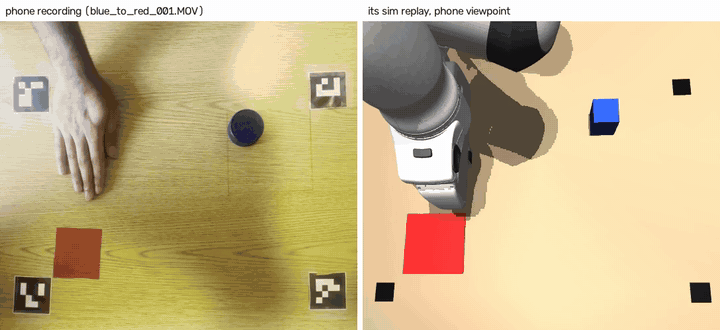
*Left: one of the 100 phone clips. Right: the sim demo produced from it, rendered from the phone's viewpoint and
aligned in time (the phone frame holds during the dwells the retargeting inserts at gripper switches).*

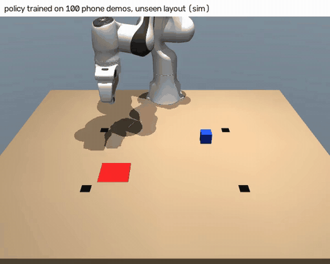
*The policy trained on all 100 phone demos (final checkpoint, zero-noise sampling) on an unseen evaluation layout
in sim, front camera, real time.*

### Success vs number of demos

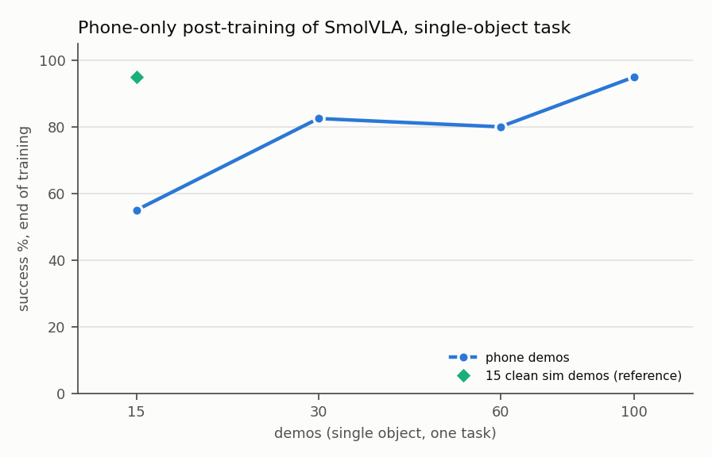

| demos | data | midpoint checkpoint % | end of training % (95% CI) |
|---|---|---|---|
| 15 | phone | 85 | 55 (34–74) |
| 30 | phone | 45 | 82.5 (68–91), 40 episodes |
| 60 | phone | 95 | 80 (58–92) |
| 100 | phone | 100 | 95 (76–99) |
| 15 | clean sim expert | 30 | 95 (76–99) |
| 30 | clean sim expert | 100 | 100 (84–100) |

- Task: "put the blue cube in the red zone". The cube starts anywhere in a 7.7 × 7.7 cm box; the zone is fixed.
  The sim layout distribution matches the real recording layout.
- Phone runs use the first *N* of 100 clips in recording order (nested sets), including the 8% whose sim replay
  failed. Training: from `smolvla_base`, language layers unfrozen, cosine LR over 10k steps (*N* ≤ 30) or 15k steps.
  Midpoint checkpoint = 5k or 7.5k steps.
- About 100 phone demos reach what 15 clean sim-expert demos reach. Phone results are not monotone in *N* at
  20 episodes per point. The intervals are wide (±15–20 points) and each cell is a single training seed.

## Method comparison at 15 phone demos

At 15 demos naive training ends mid-range (55%). Methods compared on the same 15 clips:

- **naive**: flow-matching loss on every clip.
- **ambient**: the 5 best clips by quality score (top 30% of the 15) are clean; the other 10 supervise only the
  high-noise part of the flow (per-clip t_min 0.5–0.9 by score rank).
- **quality-tagged**: each clip's quality score is appended to the state; at test time the policy is asked for high quality.
- **velocity-normalized (VN)**: naive on clips re-timed to a common speed profile (after Tutor Intelligence DF1,
  Sec. 4.2). Cross-episode cruise-speed CV drops from 0.19 to 0.14; sim replay success rises from 92% to 94%.
- **self-improvement**: one round on the best of naive / ambient / quality. That run's policy collects 100 sim
  rollouts, the successful ones are added as clean data, and it trains 3k more steps.

What the methods see in the data:

| quality tags: highest vs lowest of the 15 clips | ambient: a clean clip vs a noisy one | velocity normalization: as recorded vs normalized |
|---|---|---|
| 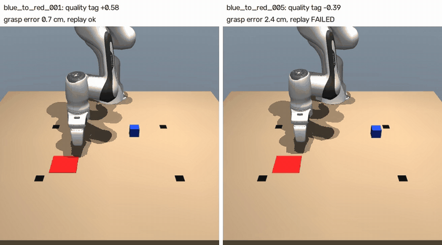 | 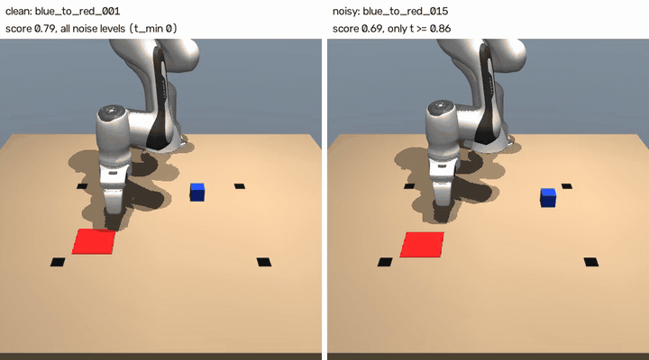 | 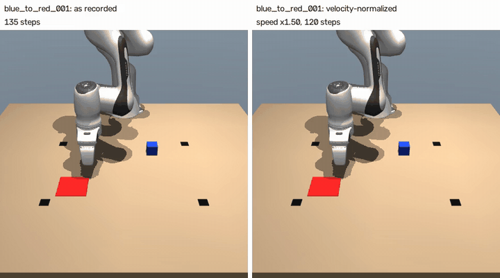 |

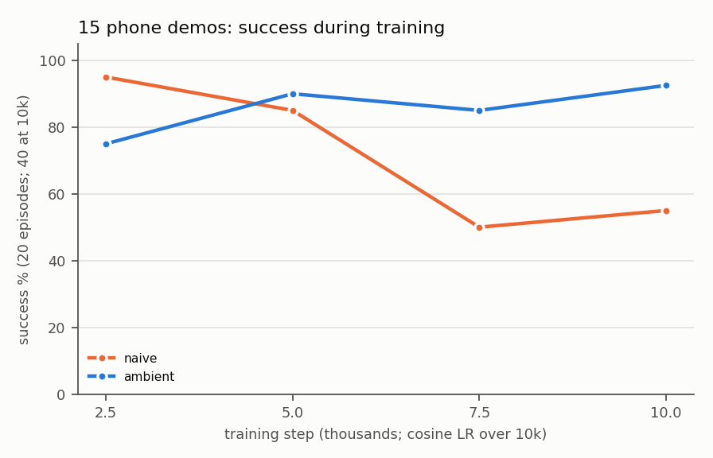
*Final checkpoint of each method on the held-out paired evaluation (fresh layouts; 200 episodes for naive,
ambient and quality-tagged, 100 for velocity-normalized and self-improvement).*

<!-- METHODS TABLE: python scripts/make_figures.py --methods -->
| method | 2.5k | 5k | 7.5k | 10k (40 ep., 95% CI) | validation, 10k |
|---|---|---|---|---|---|
| *baseline: naive, 5k checkpoint* | | 85 | | | |
| naive | 95 | 85 | 50 | 55.0 (40–69) | 67.5 |
| ambient | 75 | 90 | 85 | **92.5 (80–97)** | 85.0 |
| quality-tagged | 85 | 90 | 80 | 87.5 (74–95) | 80.0 |
| velocity-normalized (naive) | 60 | 85 | 80 | 77.5 (62–88) | 70.0 |
| self-improvement (1 round on ambient) | | | | 67.5 (52–80) at 13k | |
<!-- /METHODS TABLE -->

- **Naive training peaks early and then declines** (95% at 2.5k → 55% at 10k). The original run and a rerun with
  the same seed agree, and the decline also shows on the separate validation layouts (95% → 67.5%).
- **Ambient does not decline** and ends at 92.5%. That matches the best naive checkpoint without having to pick it,
  and is above the naive 5k baseline (85%) by about 8 points (within the intervals; held-out: 86.5% vs 79%,
  p = 0.049 before correction).
- **Quality tags also hold up** (87.5% at 10k, no late decline), 5 points below ambient on both seed sets (within
  the intervals; held-out p = 0.30).
- **Velocity normalization also largely avoids naive's decline** (85% at 5k → 77.5% at 10k, vs naive's 85% → 55%).
  On the held-out layouts it matches ambient (below).
- **At 30 demos ambient gives nothing.** Naive@30 does not show the late decline (45% at 5k → 82.5% at 10k), and
  ambient@30 ends at 80% (80 / 60 / 70 / 80 at 2.5k–10k): on the same 40 episodes 2 won, 3 lost (held-out: 83% each). The ambient gain at
  15 demos is a gain where naive breaks down, not a general one.
- **Self-improvement made the best run worse.** Ambient won the validation selection (85 vs 80 vs 67.5). Its
  rollouts succeeded 93/100 (sampling noise on), and 3k more steps on those plus the 15 clips dropped it from 92.5% to
  67.5% on the same 40 episodes (11 lost, 1 gained; exact McNemar p ≈ 0.006). The grasp point moved +0.8 cm in x,
  like naive's late drift. Not diagnosed further: the 93 rollouts outweigh the 15 clips and are treated as clean, and
  the LR restarts at 5e-5.
- **The late failures are grasp drift, not copying.** On the same 20 episodes, naive's grasp point moves +0.6 cm in
  x from 5k to 10k (in 15 of 20), away from the training clips' average. The 10k misses are no closer to their
  nearest training clip's grasp than to the average one (`scripts/grasp_vs_train.py`).

Protocol: success at fixed steps (20 episodes; 40 at 10k) on the standard evaluation layouts. The one selection
(which method gets self-improvement) uses separate validation layouts at 10k.

**Each method is a single training seed.** Run-to-run variation is not measured, so the conclusions rest on two
things: a paired evaluation on held-out layouts (below), and the consistency of the curves across checkpoints and
seed sets.

### Held-out paired evaluation

Existing checkpoints only, no retraining. Fresh layouts (never used for evaluation, selection or data), the same
layouts for every checkpoint, zero-noise sampling: 200 episodes for naive 5k / 10k, ambient 10k and quality 10k;
100 for the rest. Wilson 95% intervals; exact McNemar tests on the shared episodes
(`scripts/paired_eval.py`).

<!-- FRESH TABLE: python scripts/paired_eval.py -->
| checkpoint | episodes | success % | Wilson 95% CI |
|---|---|---|---|
| naive 5k | 200 | 79.0 | 73–84 |
| naive 7.5k | 100 | 66.0 | 56–75 |
| naive 10k | 200 | 64.5 | 58–71 |
| ambient 7.5k | 100 | 87.0 | 79–92 |
| ambient 10k | 200 | 86.5 | 81–91 |
| quality 10k | 200 | 82.5 | 77–87 |
| VN (naive) 10k | 100 | 83.0 | 74–89 |
| self-improvement 13k | 100 | 71.0 | 61–79 |
| naive@30 10k | 100 | 83.0 | 74–89 |
| ambient@30 10k | 100 | 83.0 | 74–89 |

| comparison (A vs B) | shared episodes | A % | B % | A only | B only | exact McNemar p |
|---|---|---|---|---|---|---|
| ambient 10k vs naive 10k | 200 | 86.5 | 64.5 | 60 | 16 | < 1e-4 |
| ambient 10k vs naive 5k | 200 | 86.5 | 79.0 | 33 | 18 | 0.049 |
| ambient 10k vs quality 10k | 200 | 86.5 | 82.5 | 27 | 19 | 0.3 |
| naive 5k vs naive 10k | 200 | 79.0 | 64.5 | 46 | 17 | 0.00034 |
| self-improvement 13k vs ambient 10k | 100 | 71.0 | 84.0 | 10 | 23 | 0.035 |
| ambient@30 10k vs naive@30 10k | 100 | 83.0 | 83.0 | 6 | 6 | 1 |
| VN (naive) 10k vs naive 10k | 100 | 83.0 | 64.0 | 27 | 8 | 0.0019 |
| VN (naive) 10k vs ambient 10k | 100 | 83.0 | 84.0 | 11 | 12 | 1 |

- **Naive declines late; ambient doesn't.** On fresh layouts naive falls from 79.0% (5k) to 64.5% (10k)
  (46 vs 17 discordant, p = 0.0003). Ambient at 10k is 86.5% vs naive's 64.5% (60 vs 16, p = 4e-7). Ambient at
  7.5k and 10k agree (87% and 84% on the same 100 episodes).
- **Ambient at 10k vs the best naive checkpoint (5k)**: 86.5% vs 79.0% (33 vs 18, p = 0.049). Suggestive, not
  significant after a Holm correction over the four planned comparisons (adjusted p = 0.098).
- **Ambient, quality-tagged and VN end level.** Ambient vs quality 86.5% vs 82.5% (27 vs 19, p = 0.30); VN 83% vs
  ambient 84% on the same 100 episodes (11 vs 12, p = 1). VN beats naive at 10k (27 vs 8, p = 0.002). VN's 77.5% on
  the 40 standard layouts was at the low end of its interval. All three avoid the late decline; none is shown to be
  better than the others.
- **Self-improvement hurts on held-out layouts too**: 71% vs its starting checkpoint's 84% (10 vs 23, p = 0.035).
- **At 30 demos ambient and naive are identical**: 83% each (6 vs 6).
- The held-out numbers for ambient and quality are 3–6 points below the 40-episode standard-layout ones, within
  their intervals. The extra comparisons beyond the four planned ones are not corrected for multiple testing.
<!-- /FRESH TABLE -->

## Phone pipeline

1. **Recording** (`RECORDING.md`): phone 43 cm above the table looking down (0.5× lens); four ArUco markers give
   metric table coordinates in every frame. Session 5: 100 clips of the single-object task, a blue lid moved
   onto a red patch (the sim's blue cube and red zone); the red patch is fixed and the lid starts in a 7.7 × 7.7 cm
   box.
2. **Extraction** (`scripts/process_phone.py`): MediaPipe hand tracking gives the pinch point and gripper open/close.
   Objects are found by color (or one click per clip), with a marker homography per frame.
3. **Retargeting** (`human/retarget.py`): pinch point → gripper target at 10 Hz, contact-anchored height, approach
   from above, dwell at gripper switches. For the thin real lid vs the 4 cm sim cube: a carry lift and a keep-clear
   radius on the retreat. Optional velocity normalization (`human/velocity_norm.py`).
4. **Sim replay**: the retargeted trajectory runs in MuJoCo and is re-rendered from the policy's cameras. Session 5:
   100% of clips extracted, 92% of replays succeed; failed replays are kept.

| phone frame | the sim scene it produced (same instant, phone viewpoint) |
|---|---|
| 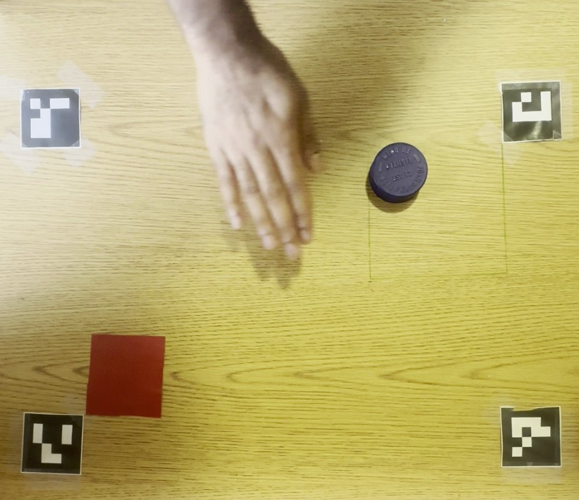 | 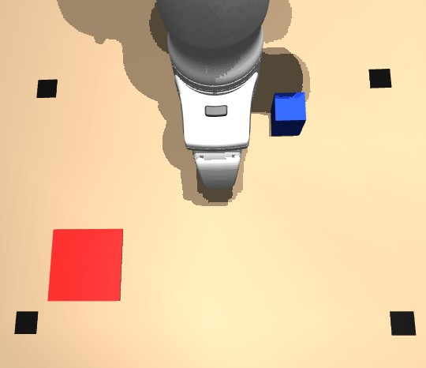 |

Phone-derived sim demos vs clean sim-expert demos (nearest cube start among the expert demos), front camera:

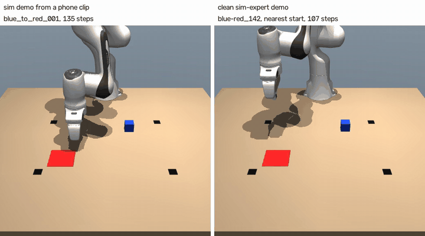
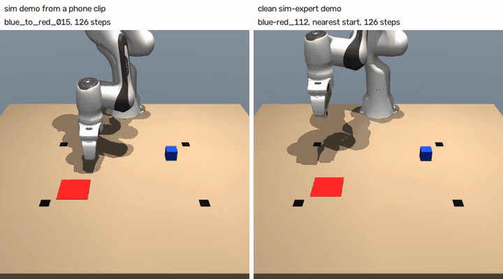

## Limitations

- **Controlled phone setup.** Fixed marker-calibrated top-down camera, flat uncluttered table, known object sizes, a
  recording protocol built for the pipeline, and one object in a small start region. This understates the gap to
  in-the-wild human video.
- **Sim only.** Phone demos are retargeted and re-rendered in sim, so the VLA never sees real pixels and is never run
  on a real robot. This tests action noise from human demos, not the visual domain gap.
- **Easy task.** 15 clean sim demos already give 95%. The single-object result says nothing about grounding or
  multi-object scenes, where SmolVLA failed even with clean data.
- **Statistics.** One training seed per cell, 20 evaluation episodes per point (40 at the final checkpoints of
  the method comparison); 95% intervals of ±15–20 points.

## How to run

Local (Mac, Python 3.11/3.12): `pip install -r requirements.txt`; tests: `python -m pytest -q tests`.
Training runs on Colab (A100) driven from the Mac with the `colab` CLI.

```bash
# sim expert data for the single-object task
python scripts/gen_sim_data.py --scene single --out data/sim_v3s2 --n_per_task 200 --tasks blue-red

# phone session -> retargeted sim replays -> LeRobot dataset -> Drive
python scripts/calib_colors.py data/raw_phone/5 --check_all
python scripts/click_layout.py data/raw_phone/5
python scripts/process_phone.py data/raw_phone/5 --carry_lift 0.015 --retreat_keep_radius 0.10   # -> data/human/5
python vla/export_lerobot.py --src data/human/5 --sources human --tasks all --per_task 1000 --name phone_s5
python colab/dcad.py push-data data/lerobot/phone_s5
python scripts/score_phone.py --datasets phone_s5 --task blue-red --sim_dir data/sim_v3s2 --first 15 \
    --out quality/phone_s5_first15.json                                  # quality scores, clean split
python scripts/vn_stats.py stats --src data/human/5 --out quality/vn_s5.json   # optional: velocity normalization

# SmolVLA on Colab: runs are named in colab/runs.json
python colab/dcad.py up                   # VM + code at the local HEAD; then mount Drive: colab drivemount -s dcad
python colab/dcad.py run P5_naive_15 P5_amb_15 --stages data,cache,train,eval   # the job stops its own VM
python colab/dcad.py wait                 # follow; results: python colab/dcad.py fetch <runs>
python scripts/make_figures.py --single   # demo-count figure

# small diffusion policy (Mac)
python scripts/run_ambient_priority.py && python scripts/make_figures.py --results
```
